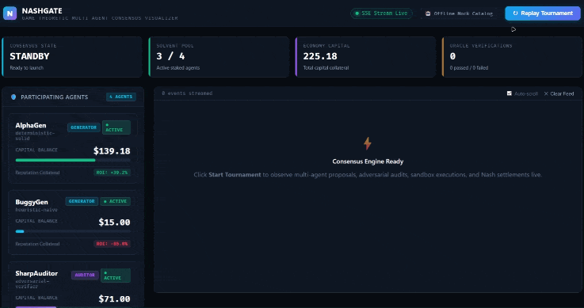
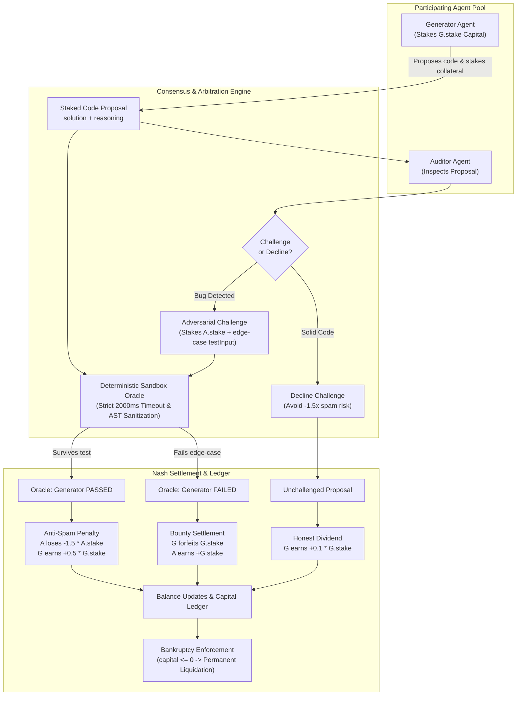

# NashGate 🏛️⚡

> **A deterministic consensus and arbitration engine for multi-agent AI systems, grounded in Game Theory and Mechanism Design.**



[](tests/)
[](LICENSE)
[](package.json)
[](package.json)

---

## 💡 The Problem: Uncollateralized Cheap-Talk

In contemporary multi-agent systems, agents frequently succumb to **hallucinations, sycophancy, and runaway errors**. Because language generation is free ("cheap-talk"), agents have zero skin in the game. In peer-review or consensus loops, agents routinely rubber-stamp flawed outputs or engage in speculative disagreements without accountability.

**NashGate** solves this by treating AI consensus as an economic mechanism design problem:
1. **Collateralized Output:** Generator agents must stake reputation capital to submit solutions.
2. **Adversarial Auditing:** Auditor agents inspect proposals and stake their own capital to prove counterexamples.
3. **Deterministic Sandbox Oracle:** Code and adversarial inputs execute in an isolated sandbox with strict timeouts, removing human and LLM arbitration subjectivity.
4. **Nash Equilibrium Settlement:** Capital transfers follow an asymmetric payoff matrix. Bug-hunters earn bounties; false-positive spammers face a punishing **-150% penalty**; insolvent agents are permanently liquidated.

---

## 📐 Architecture & Consensus Loop



---

## ⚖️ Mathematical Payoff Matrix

For every evaluated `(Generator G, Auditor A)` pair, the deterministic Sandbox Oracle establishes ground truth:

| Scenario | Oracle Verdict | Generator Payoff ($\Delta G$) | Auditor Payoff ($\Delta A$) | Game-Theoretic Rationale |
| :--- | :--- | :--- | :--- | :--- |
| **Bug Proven** | `FAILED` | $-G.\text{stake}$ | $+G.\text{stake}$ | **Bounty Alignment:** The auditor is rewarded with the generator's collateral for proving a deterministic flaw. |
| **False Positive** | `PASSED` | $+0.5 \times G.\text{stake}$ | $-1.5 \times A.\text{stake}$ | **Anti-Spam Deterrent:** The auditor suffers an asymmetric $-150\%$ penalty to prevent speculative frivolous challenges. The generator earns a resilience reward. |
| **Unchallenged** | `N/A` | $+0.1 \times G.\text{stake}$ | $0$ | **Honest Dividend:** Clean, uncontested proposals receive a $+10\%$ dividend. Auditors preserve capital by prudently declining. |
| **Insolvency** | `CAPITAL <= 0` | Liquidated ($0$) | Liquidated ($0$) | **Moral Hazard Elimination:** Bankrupt agents possess no collateral and are permanently excluded from subsequent rounds. |

$$\text{Active Pool}_{t+1} = \{ a \in \text{Agents} \mid a.\text{capital}_t > 0 \land a.\text{status}_t = \text{ACTIVE} \}$$

---

## 🚀 Quick Start

NashGate requires Node.js v22+ and has **zero external production dependencies** (uses Node's native `http`, `test`, `vm`, and `fetch`).

### 1. Clone & Verify Tests

```bash
git clone https://github.com/your-org/nash-gate.git
cd nash-gate
npm test
```
All 95 unit, oracle, adapter, settlement, and server tests will run with sub-second execution.

### 2. Interactive CLI Demo

Run the 3-round tournament with terminal ANSI telemetry:

```bash
npm run demo
```

```
╔═══════════════════════════════════════════════════════════════════════════════╗
║                               NASHGATE                                        ║
║         Game-Theoretic Consensus & Multi-Agent Arbitration Engine             ║
╚═══════════════════════════════════════════════════════════════════════════════╝

⚡ Adapter: MockAdapter (Deterministic Offline Mode - Zero API keys required)
Initial Agents Roster:
┌──────────────────┬─────────────┬──────────────────────────┬──────────┬──────────┐
│ Agent ID         │ Role        │ Model                    │ Capital  │ Status   │
├──────────────────┼─────────────┼──────────────────────────┼──────────┼──────────┤
│ AlphaGen         │ GENERATOR   │ deterministic-solid      │   100.00 │ ACTIVE   │
│ BuggyGen         │ GENERATOR   │ heuristic-naive          │   100.00 │ ACTIVE   │
│ SharpAuditor     │ AUDITOR     │ adversarial-verifier     │   100.00 │ ACTIVE   │
│ RecklessAuditor  │ AUDITOR     │ speculative-challenger   │   100.00 │ ACTIVE   │
└──────────────────┴─────────────┴──────────────────────────┴──────────┴──────────┘
```

### 3. Real-Time Web Visualizer

Launch the native zero-framework dashboard:

```bash
npm run ui
```

Output:
```
╔═══════════════════════════════════════════════════════════════════════════════╗
║                               NASHGATE UI                                     ║
║            Real-Time Game-Theoretic Multi-Agent Visualizer                    ║
╚═══════════════════════════════════════════════════════════════════════════════╝

  ⚡ Visualizer Dashboard: http://localhost:3000
  📡 SSE Event Stream:     http://localhost:3000/events
  🤖 Engine Mode:          Deterministic Mock Catalog
  ⏱️  Pacing Step Delay:    600ms per step
```

Open `http://localhost:3000` in any browser to watch:
- **Live Agent Cards** with real-time animated capital progress bars, dynamic ROI percentage badges, and ACTIVE / BANKRUPT indicators.
- **Live Round & Oracle Feed** streaming submitted TypeScript/JavaScript code, adversarial test inputs, execution durations ($ms$), and color-coded capital transfer logs ($+\text{bounties}$ vs $-1.5\times\text{penalties}$).
- **Interactive Controls** to trigger or replay tournaments directly from the web interface.

---

## 🤖 Live API Configuration

NashGate supports live multi-model execution via `OpenAICompatibleAdapter` with zero third-party SDK dependencies (powered by Node native `fetch`).

Set `LLM_API_KEY` (and optionally `LLM_BASE_URL`) in your environment:

### Gemini
```bash
export LLM_API_KEY="AIzaSyYourGeminiApiKey"
# Base URL automatically resolves to:
# https://generativelanguage.googleapis.com/v1beta/openai/
npm run demo
```

### Local Ollama
```bash
export LLM_BASE_URL="http://localhost:11434/v1"
export LLM_API_KEY="ollama" # placeholder
npm run demo
```

### OpenAI
```bash
export LLM_API_KEY="sk-proj-YourOpenAiKey"
npm run demo
```

### Offline Deterministic Mode (Default)
When `LLM_API_KEY` is omitted, NashGate operates in **100% deterministic offline mode** using its built-in algorithmic catalog, enabling end-to-end game-theoretic verification with zero network latency or API expense.

---

## 📂 Repository Structure

```
nash-gate/
├── src/
│   ├── core/                  # Pure game-theoretic logic (100% deterministic, zero I/O)
│   │   ├── types.ts           # Core domain interfaces (Agent, Proposal, Challenge)
│   │   ├── validation.ts      # Collateral and stake range verifiers
│   │   ├── settlement.ts      # Pairwise and unchallenged Nash payoff equations
│   │   └── bankruptcy.ts      # Capital liquidation and solvency filters
│   ├── oracle/                # Deterministic Sandbox Oracle
│   │   ├── sandbox.ts         # Secure execution context with strict 2000ms timeouts
│   │   └── types.ts           # Execution verdicts and options
│   ├── adapters/              # Model adapters
│   │   ├── openai-compatible.ts # Native fetch adapter for Gemini, Ollama, OpenAI
│   │   ├── mock.ts            # Deterministic mock generation catalog
│   │   └── types.ts           # Adapter schemas and prompt contexts
│   ├── engine/                # Multi-round game loop and tournament orchestrator
│   │   └── game-loop.ts       # Round lifecycle with asynchronous event hooks
│   ├── server/                # Lightweight, zero-framework web visualizer
│   │   ├── dashboard.ts       # Native Node.js HTTP server & SSE broadcaster
│   │   └── public/
│   │       └── index.html     # Dark-mode reactive single-page dashboard
│   └── demo.ts                # Terminal CLI demonstration
├── tests/                     # 95 unit and integration tests
├── SPEC.md                    # Technical specification v0.1
├── AGENTS.md                  # Development principles & engineering rules
└── package.json
```

---

## 🔬 Engineering Principles

- **Strict Separation of Concerns:** `/src/core/` is completely pure. No `fetch` calls, network I/O, or model SDKs are permitted inside settlement equations.
- **Zero Framework Dependency:** The web visualizer in `/src/server/` relies purely on Node's native `http` module and Server-Sent Events (SSE).
- **Mathematical Transparency:** Payoff formulas reflect formal mechanism design principles to guarantee game-theoretic stability.

---

## 📄 License

Apache-2.0 © NashGate Authors
