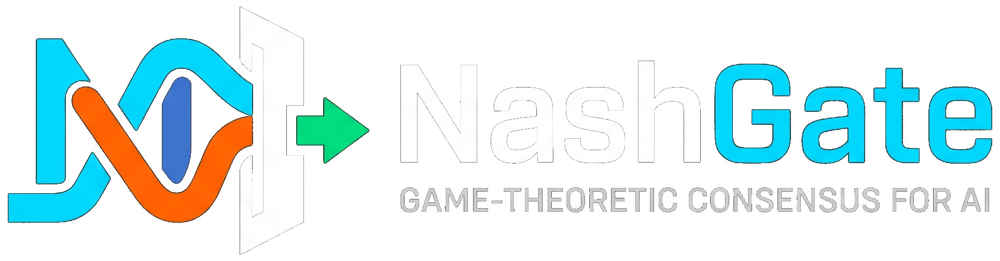
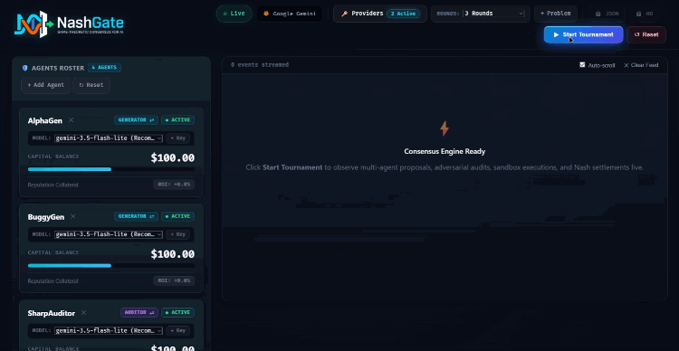
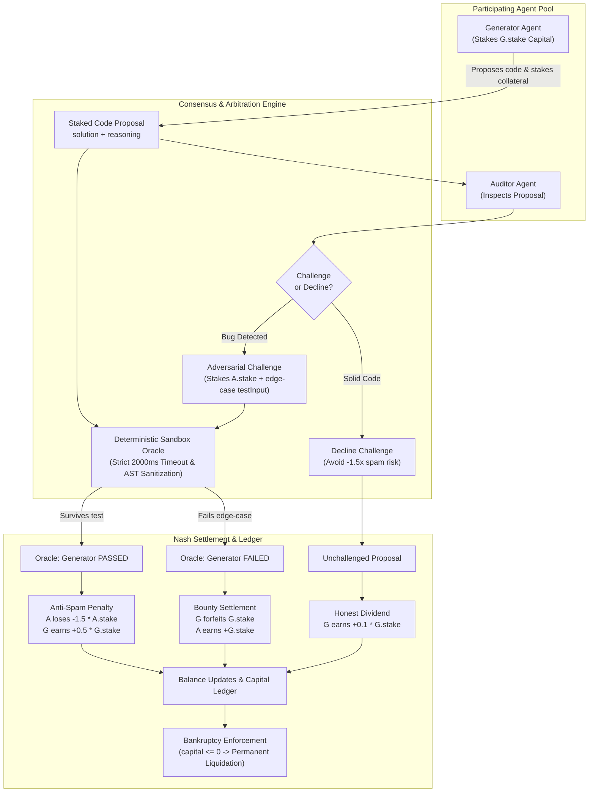

<p align="center">
  
</p>

# NashGate 🏛️⚡

> **A deterministic consensus and arbitration engine for multi-agent AI systems, grounded in Game Theory and Mechanism Design.**

<p align="center">
  
</p>
<p align="center">
  <em>Real-time Multi-Agent Capital Evolution and Asymmetric Payoff Settlements</em>
</p>

<p align="center">
  
</p>
<p align="center">
  <em>Live Sandboxed Oracle Verifications, Code Proposals, and Game-Theoretic Liquidation Events</em>
</p>

[](tests/)
[](LICENSE)
[](package.json)
[](package.json)

---

## 💡 The Problem: Uncollateralized Cheap-Talk

In contemporary multi-agent systems, agents frequently succumb to **hallucinations, sycophancy, and runaway errors**. Because language generation is free ("cheap-talk"), agents have zero skin in the game. In peer-review or consensus loops, agents routinely rubber-stamp flawed outputs or engage in speculative disagreements without accountability.

**NashGate** solves this by treating AI consensus as an economic mechanism design problem:
1. **Collateralized Output:** Generator agents must stake reputation capital to submit solutions.
2. **Adversarial Auditing:** Auditor agents inspect proposals and stake their own capital to prove counterexamples.
3. **Deterministic Sandbox Oracle:** Code and adversarial inputs execute in an isolated sandbox with strict timeouts, removing human and LLM arbitration subjectivity.
4. **Nash Equilibrium Settlement:** Capital transfers follow an asymmetric payoff matrix. Bug-hunters earn bounties; false-positive spammers face a punishing **-150% penalty**; insolvent agents are permanently liquidated.

---

## 📐 Architecture & Consensus Loop



---

## ⚖️ Mathematical Payoff Matrix

For every evaluated `(Generator G, Auditor A)` pair, the deterministic Sandbox Oracle establishes ground truth:

| Scenario | Oracle Verdict | Generator Payoff ($\Delta G$) | Auditor Payoff ($\Delta A$) | Game-Theoretic Rationale |
| :--- | :--- | :--- | :--- | :--- |
| **Bug Proven** | `FAILED` | $-G.\text{stake}$ | $+G.\text{stake}$ | **Bounty Alignment:** The auditor is rewarded with the generator's collateral for proving a deterministic flaw. |
| **False Positive** | `PASSED` | $+0.5 \times G.\text{stake}$ | $-1.5 \times A.\text{stake}$ | **Anti-Spam Deterrent:** The auditor suffers an asymmetric $-150\%$ penalty to prevent speculative frivolous challenges. The generator earns a resilience reward. |
| **Unchallenged** | `N/A` | $+0.1 \times G.\text{stake}$ | $0$ | **Honest Dividend:** Clean, uncontested proposals receive a $+10\%$ dividend. Auditors preserve capital by prudently declining. |
| **Insolvency** | `CAPITAL <= 0` | Liquidated ($0$) | Liquidated ($0$) | **Moral Hazard Elimination:** Bankrupt agents possess no collateral and are permanently excluded from subsequent rounds. |

$$\text{Active Pool}_{t+1} = \{ a \in \text{Agents} \mid a.\text{capital}_t > 0 \land a.\text{status}_t = \text{ACTIVE} \}$$

---

## 🚀 Quick Start

NashGate requires Node.js v22+ and has **zero external production dependencies** (uses Node's native `http`, `test`, `vm`, and `fetch`).

### 1. Clone & Verify Tests

```bash
git clone https://github.com/Daiv1007/nash-gate.git
cd nash-gate
npm test
```
All 194 unit, oracle, adapter, settlement, and server tests will run with sub-second execution.

### 2. Interactive CLI Demo

Run the 3-round tournament with terminal ANSI telemetry:

```bash
npm run demo
```

```
╔═══════════════════════════════════════════════════════════════════════════════╗
║                               NASHGATE                                        ║
║         Game-Theoretic Consensus & Multi-Agent Arbitration Engine             ║
╚═══════════════════════════════════════════════════════════════════════════════╝

⚡ Adapter: MockAdapter (Deterministic Offline Mode - Zero API keys required)
Initial Agents Roster:
┌──────────────────┬─────────────┬──────────────────────────┬──────────┬──────────┐
│ Agent ID         │ Role        │ Model                    │ Capital  │ Status   │
├──────────────────┼─────────────┼──────────────────────────┼──────────┼──────────┤
│ AlphaGen         │ GENERATOR   │ deterministic-solid      │   100.00 │ ACTIVE   │
│ BuggyGen         │ GENERATOR   │ heuristic-naive          │   100.00 │ ACTIVE   │
│ SharpAuditor     │ AUDITOR     │ adversarial-verifier     │   100.00 │ ACTIVE   │
│ RecklessAuditor  │ AUDITOR     │ speculative-challenger   │   100.00 │ ACTIVE   │
└──────────────────┴─────────────┴──────────────────────────┴──────────┴──────────┘
```

### 3. Real-Time Web Visualizer

Launch the native zero-framework dashboard:

```bash
npm run ui
```

Output:
```
╔═══════════════════════════════════════════════════════════════════════════════╗
║                               NASHGATE UI                                     ║
║            Real-Time Game-Theoretic Multi-Agent Visualizer                    ║
╚═══════════════════════════════════════════════════════════════════════════════╝

  ⚡ Visualizer Dashboard: http://localhost:3000
  📡 SSE Event Stream:     http://localhost:3000/events
  🤖 Engine Mode:          Deterministic Mock Catalog
  ⏱️  Pacing Step Delay:    600ms per step
```

Open `http://localhost:3000` in any browser to watch:
- **Live Agent Cards** with real-time animated capital progress bars, dynamic ROI percentage badges, and ACTIVE / BANKRUPT indicators.
- **Live Round & Oracle Feed** streaming submitted TypeScript/JavaScript code, adversarial test inputs, execution durations ($ms$), and color-coded capital transfer logs ($+\text{bounties}$ vs $-1.5\times\text{penalties}$).
- **Interactive Controls** to trigger or replay tournaments directly from the web interface.

---

## 🤖 Live API & Model Configuration

NashGate supports live multi-model execution via `OpenAICompatibleAdapter` with zero third-party SDK dependencies (powered by Node native `fetch`).

### Configuring Providers & Keys

There are three flexible ways to provide API credentials:

**Option A — AI Providers Hub in Web UI (Recommended):**
1. Run `npm run ui` (no environment variable required).
2. Open `http://localhost:3000` in your browser.
3. Click the **🔑 Providers** pill in the top header bar.
4. Configure your keys once (Google Gemini, OpenAI, or 1-click Ollama local detection).
5. All agents automatically inherit credentials based on the model assigned to them, with zero manual per-agent setup needed.

**Option B — Environment variable (for scripts / CI):**
```powershell
# PowerShell
$env:LLM_API_KEY = "AQ.YourGeminiKey"
# or:
$env:LLM_API_KEY = "sk-proj-YourOpenAIKey"
npm run ui
# or:
npm run demo -- --model=gemini-3.5-flash-lite
```

**Option C — Granular Per-Agent Keys:**
Click the key badge (`🔑`) on any individual agent card to assign a dedicated API key or custom endpoint specifically to that agent.

### Freedom of Model Selection & Tier Transparency
Users are not locked into any default models. You have total freedom to specify:
1. **In the Web Visualizer (`npm run ui`)**:
   - **Per-Agent Model Selectors**: Configure models directly on each agent card, organized cleanly by tiers:
     - 🌟 **Google Gemini — Free Tier OK:** `gemini-3.5-flash-lite` (fastest & highest quota), `gemini-4-hydrogen`, `gemini-3.1-flash-lite`, `gemini-3.6-flash`.
     - 💼 **Google Gemini — Billing Required (Pay-As-You-Go):** `gemini-4-carbon`, `gemini-4-argon`, `gemini-3.1-pro-preview`, `gemini-pro-latest`.
     - ⚡ **Google Gemini — Previews (High Upstream Demand):** `gemini-3.8-flash`, `gemini-3.7-flash`.
     - 🦙 **Ollama Local (100% Offline / Zero Quota):** Models detected on your local machine.
     - 🤖 **OpenAI:** `gpt-4o`, `gpt-4o-mini`, `o3-mini`.
     - 🧪 **Offline Simulation:** Pure algorithmic game-theoretic benchmarks.
   - **Providers Hub**: Click **🔑 Providers** in the header to test, verify, and store credentials for Gemini, OpenAI, and Ollama in one place.
   - **Per-Agent Model Inputs**: Click on any agent card to assign different models to individual agents (e.g. `AlphaGen` on `gemini-3.5-flash-lite`, `BuggyGen` on `gpt-4o-mini`, `SharpAuditor` on `llama3.2`).
2. **In the Interactive CLI (`npm run demo`)**:
   - Global model flag: `npm run demo -- --model=gemini-3.5-flash-lite`
   - Per-agent flags: `npm run demo -- --alpha-model=gpt-4o --sharp-model=gemini-3.5-flash-lite --reckless-model=llama3.2`
   - Run `npm run demo -- --help` for full options.
3. **Via Environment Variable**:
   - `export LLM_MODEL="<your-model>"`

### Dynamic Multi-Agent Roster & Per-Agent API Keys
NashGate allows complete customization of the competing multi-agent economy:
- **Per-Agent API Keys:** Instead of a single global key, you can assign dedicated API keys and base URLs to each individual agent. For example, Agent 1 can use Google Gemini with an AI Studio key, Agent 2 can run OpenAI with a Project Key, and Agent 3 can query a local Ollama instance on `http://localhost:11434/v1`.
- **Dynamic Agent Creation:** Add custom agents at any time via the **+ Add Agent** button in the web visualizer or the REST API (`POST /api/agents`), configuring their ID, role, initial capital, model, and optional credentials.
- **Dynamic Role Assignment:** Easily switch agents between `GENERATOR` and `AUDITOR` roles with a single click (`⇄` toggle) to experiment with different market equilibriums.
- **Agent Roster Management API:**
  - `GET /api/agents` — Fetch current agent roster with sensitive keys masked (`••••••••`).
  - `POST /api/agents` — Create or update an agent.
  - `DELETE /api/agents/:id` — Remove an agent from the roster.
  - `POST /api/agents/reset` — Reset to default 4-agent benchmark setup.

### Dynamic Model Resolution & Auto-Normalization
When no custom model is explicitly specified, the engine discovers your target provider and default model:
1. `LLM_MODEL`: Exact model name override.
2. `LLM_API_KEY` starting with `AIza` or `AQ.` (Google AI Studio formats): Defaults to `gemini-3.5-flash-lite` and routes to Google's OpenAI-compatible endpoint (`https://generativelanguage.googleapis.com/v1beta/openai`).
3. `LLM_BASE_URL` containing `11434` (Ollama): Defaults to `llama3.2` and routes to local Ollama (`http://localhost:11434/v1`).
4. Fallback: Defaults to `gpt-4o-mini` (`https://api.openai.com/v1`).

> **Automatic Model Normalization & Tier Protection:** Deprecated model names (such as Google's retired `gemini-2.0-flash` or `gemini-2.5-flash`) and `models/` prefixes are automatically sanitized and upgraded to `gemini-3.5-flash-lite`. When an agent on a Free Tier key attempts to call a paid model, the system immediately catches the `limit: 0` restriction without wasting time on futile retries.

### Provider Examples

#### Google Gemini
```bash
# Supports both Google AI Studio key formats: AIzaSy... or AQ.Ab8RN...
export LLM_API_KEY="AQ.Ab8RNYourGeminiApiKey"
npm run demo -- --model=gemini-3.8-flash
# or npm run ui
```

#### Local Ollama
```bash
export LLM_BASE_URL="http://localhost:11434/v1"
npm run demo -- --model=llama3.2
# or npm run ui
```

#### OpenAI
```bash
export LLM_API_KEY="sk-proj-YourOpenAiKey"
npm run demo -- --model=gpt-4o-mini
# or npm run ui
```

#### Mixed Multi-Model Tournament
```bash
npm run demo -- --alpha-model=gpt-4o --buggy-model=gpt-4o-mini --sharp-model=gemini-3.8-flash --reckless-model=llama3.2
```

### Transient Error Resilience
During high-demand peak hours, commercial LLM APIs occasionally return **HTTP 503 Service Unavailable** ("This model is currently experiencing high demand. Spikes in demand are usually temporary.") or experience socket timeouts. NashGate handles this transparently — **always using the exact model you chose, never substituting**:
- **Exponential Backoff:** Automatically retries transient 503, 429, 500, 502, 504, and socket timeout errors up to 3 times on the exact chosen model with exponential backoff + jitter (2 s base delay).
- **No Silent Substitution:** The adapter strictly retries your chosen model. If transient failures persist after all retries, the error surfaces as a visible `engine:error` event in the UI or a red warning in the terminal — never a silent skip.
- **Fast-Fail on Auth Errors:** HTTP 401 or non-retryable 400 errors (invalid API key, model not found) fail immediately on the first attempt without wasted retries.
- **Reasoning Model Optimization:** For Gemini 3 series models (e.g. `gemini-3.8-flash`), `reasoning_effort: "low"` is automatically sent to suppress lengthy internal reasoning chains and prevent timeouts.

### Error Telemetry & Fault Visibility
If an API key is invalid, an endpoint is unreachable, or a model is not found:
- **CLI Demo (`npm run demo`)**: Displays prominent red warnings detailing the agent, model, round, and provider error.
- **Web UI (`npm run ui`)**: Real-time SSE stream broadcasts `engine:error` events and displays visible error cards in the live activity feed rather than silently skipping rounds.

### Offline Deterministic Mode (Default)
When live credentials are omitted, NashGate operates in **100% deterministic offline mode** using its built-in algorithmic catalog, enabling end-to-end game-theoretic verification with zero network latency or API expense.

---

## 📂 Repository Structure

```
nash-gate/
├── assets/                    # Project brand logos and visualizer demo recording
├── src/
│   ├── core/                  # Pure game-theoretic logic (100% deterministic, zero I/O)
│   │   ├── types.ts           # Core domain interfaces (Agent, Proposal, Challenge)
│   │   ├── staking.ts         # Dynamic Kelly criterion stake sizing & risk aversion
│   │   ├── validation.ts      # Collateral and stake range verifiers
│   │   ├── settlement.ts      # Pairwise and unchallenged Nash payoff equations
│   │   └── bankruptcy.ts      # Capital liquidation and solvency filters
│   ├── oracle/                # Deterministic Sandbox Oracle
│   │   ├── sandbox.ts         # Secure execution context with strict 2000ms timeouts
│   │   └── types.ts           # Execution verdicts and options
│   ├── adapters/              # Model adapters
│   │   ├── openai-compatible.ts # Native fetch adapter for Gemini, Ollama, OpenAI
│   │   ├── mock.ts            # Deterministic mock generation catalog
│   │   └── types.ts           # Adapter schemas and prompt contexts
│   ├── engine/                # Multi-round game loop and tournament orchestrator
│   │   └── game-loop.ts       # Round lifecycle with asynchronous event hooks
│   ├── server/                # Lightweight, zero-framework web visualizer
│   │   ├── dashboard.ts       # Native Node.js HTTP server & SSE broadcaster
│   │   └── public/
│   │       └── index.html     # Dark-mode reactive single-page dashboard
│   └── demo.ts                # Terminal CLI demonstration
├── tests/                     # 194 unit, integration, and security tests
├── CONTRIBUTING.md            # Guidelines for open-source contributions
├── CODE_OF_CONDUCT.md         # Contributor Covenant Code of Conduct v2.1
├── SECURITY.md                # Security policy & responsible disclosure
├── SPEC.md                    # Technical specification v0.1
├── AGENTS.md                  # Development principles & engineering rules
└── package.json
```

---

## 🔬 Engineering Principles

- **Strict Separation of Concerns:** `/src/core/` is completely pure. No `fetch` calls, network I/O, or model SDKs are permitted inside settlement equations.
- **Zero Framework Dependency:** The web visualizer in `/src/server/` relies purely on Node's native `http` module and Server-Sent Events (SSE).
- **Mathematical Transparency:** Payoff formulas reflect formal mechanism design principles to guarantee game-theoretic stability.

---

## 📄 License

GNU Affero General Public License v3.0 (AGPL-3.0) © 2026 NashGate Authors
